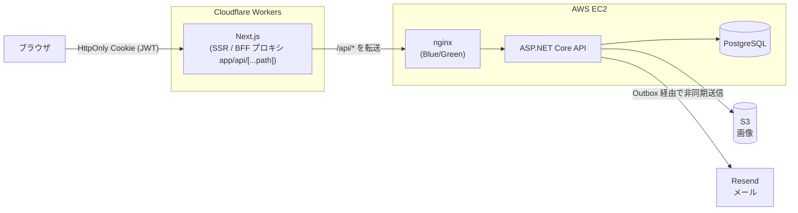

# AGENTS.md

エージェントが最初に読む、このリポジトリの正本。ここには全体像と規約だけを置き、詳細は末尾の「ドキュメント地図」から各文書を参照する。

## プロジェクト概要

nari-note は将棋記事の投稿・共有プラットフォームの Web アプリケーション。記事（棋譜・盤面の埋め込みあり）、講座（記事をまとめた連載）、タグ、いいね、フォロー等の機能を持つ。

トップレベル構成:

| パス | 内容 |
| --- | --- |
| `nari-note-backend/` | ASP.NET Core Web API（`Src/` 本体、`Tests/`、`Migrations/`、`Documents/`） |
| `nari-note-frontend/` | Next.js アプリ（`src/` 本体、`docs/`） |
| `infrastruture/` | AWS インフラ（Terraform + Terragrunt）。ディレクトリ名の綴りはこのまま |
| `spec/` | 画面・機能の仕様（`*.spec`） |
| `scripts/` | API クライアント生成、デプロイ等のスクリプト |
| `.agents/` | エージェント用スキルの実体（`.github/skills`, `.claude/skills` はここへの symlink） |

## 技術スタック

メジャーバージョンのみ記載する。正確なバージョンの正は `nari-note-frontend/package.json`、`nari-note-backend/nari-note-backend.csproj`、`global.json`、`docker-compose.yml`。

**バックエンド**
- .NET 9 / ASP.NET Core 9（Web API）
- PostgreSQL 17 + Entity Framework Core 9（Npgsql）
- JWT（System.IdentityModel.Tokens.Jwt）、BCrypt.Net-Next（パスワードハッシュ）
- Vogen（ID の ValueObject）
- Serilog（ログ）、Sentry（エラー監視）、Resend（メール送信）、AWS SDK（S3 への画像保存、SSM Parameter Store からの設定読み込み）
- テスト: xUnit v3、NSubstitute、Testcontainers（PostgreSQL）（`nari-note-backend/Tests/`）

**フロントエンド**
- Next.js 16（App Router）/ React 19 / TypeScript 5
- TanStack Query 5 + Axios
- Tailwind CSS 4、shadcn/ui（Radix UI）、lucide-react
- react-markdown で本文表示。エディタは自作の MarkdownEditor
- Cloudflare Workers へ OpenNext（`@opennextjs/cloudflare`）でデプロイ

**インフラ**
- AWS（Terraform + Terragrunt）。バックエンドと PostgreSQL は EC2 上、nginx で Blue/Green 切り替え
- フロントエンドは Cloudflare Workers

## 全体構成

- ブラウザからの API 呼び出しは同一オリジンの `/api/*` に送られ、Next.js の BFF プロキシ（`src/app/api/[...path]`）がバックエンドへ転送する。Server Component からのデータ取得は生成済みの `lib/api/server.ts` がバックエンドを直接呼ぶ。
- 認証は HttpOnly Cookie に入れた JWT。
- 詳細なシステム構成とデプロイフローは `infrastruture/docs/infra-design.md` を参照。

## バックエンドの設計原則（要約）

レイヤードアーキテクチャ + Repository パターン。依存の向きは Controller → Application(Service) → Domain ← Infrastructure。

- **API 一個につき Service 一個**（`XxxService.ExecuteAsync`）。Service はビジネスロジックに専念し、キャッシュ等のインフラ関心事は Repository / Infrastructure 層で吸収する
- Repository のインターフェースは `Src/Domain/Repository/`、実装は `Src/Infrastructure/Repository/`。DbContext は `Src/Infrastructure/Database/`
- 例外は `GlobalExceptionHandlerMiddleware` が HTTP ステータスに変換する。Controller / Service で try-catch はしない
- 書き込みリクエストのトランザクションは `TransactionMiddleware` が管理する（`[NoTransaction]` で除外）
- 認可は Controller アクションの `[Auth(AuthLevel.xxx)]`（Anonymous / Optional / Authenticated / VerifiedEmail）
- メール等の非同期配送は Outbox、未認証ユーザーの削除はバックグラウンドジョブ（`Src/Infrastructure/Job/`）
- DI 登録は `ApplicationServiceInstaller`（Service）と `InfrastructureServiceInstaller`（Repository、Gateway、ジョブ等）
- マイグレーションは全環境で起動時に自動適用、シードデータ投入は Development のみ

詳細: `nari-note-backend/Documents/architecture.md`、`backend-implementation-guide.md`

## フロントエンドの設計原則（要約）

5 層の Atomic Design（Page → Template → Organism → Molecule → Atom）。

| 層 | 配置 | 責務 |
| --- | --- | --- |
| Atom | `src/components/ui/` | 最小単位の汎用 UI（shadcn/ui もここ） |
| Molecule | `src/components/molecules/` | Atom を組み合わせた汎用部品 |
| Organism | `src/features/{feature}/organisms/`（機能横断のものは `src/components/organisms/`） | 特定の画面に属する UI のまとまり |
| Template | `src/features/{feature}/templates/` | 画面のレイアウトとレスポンシブ対応 |
| Page | `src/features/{feature}/pages/` | データ取得・状態管理等の非 UI ロジック |

- `src/app/` のルートファイルは薄く保ち、`features/` の Page を呼ぶ
- API の型・関数・フック（`src/lib/api/` の `types.ts` / `endpoints.ts` / `hooks.ts` / `server.ts`）は `scripts/api-generator.py` で生成する。手で編集しない
- 基本は Server Component。必要な場合のみ `'use client'`

詳細: `nari-note-frontend/docs/architecture.md`、`implementation-guide.md`、`api-usage.md`

## コーディング規約

### バックエンド（C#）

**命名・修飾子**
- private フィールドはアンダースコア無しのキャメルケース、`readonly` 推奨。`private` 修飾子は省略する
  - 良い例: `readonly IArticleRepository articleRepository;`
  - 悪い例: `private readonly IArticleRepository _articleRepository;`
- private フィールドへのアクセスは `this.` を付ける（例: `this.articleRepository.FindByIdAsync(id);`）

**コメント**
- XML ドキュメントコメント（`/// 
` 等）は使わず、`//` で書く
- コードを読めば分かること（What / How）は書かない。必要なときに Why だけを書く

**ValueObject（ID 型）**
- エンティティの ID は Vogen の ValueObject（`ArticleId`, `UserId`, `TagId` 等）。`NariNoteBackend.Domain.ValueObject` 名前空間に定義

**日付時刻**
- 現在時刻は DI した `TimeProvider` から取得する（`timeProvider.UtcNow()`）
- `DateTime.UtcNow` / `DateTime.Now` の直接使用は禁止（テストで時刻を固定できなくなるため）

**例外**
- 標準例外を使い分ける。ミドルウェアでのステータス変換は以下
  - 400: `ArgumentException` 系、`System.ComponentModel.DataAnnotations.ValidationException`、`InvalidOperationException`
  - 401: `UnauthorizedAccessException`
  - 404: `KeyNotFoundException`（Repository の `FindForceByIdAsync` が投げる）
- カスタム例外（`Src/Application/Exception/`）は `ConflictException`(409) / `ForbiddenException`(403) / `TooManyRequestsException`(429) / `NariNoteException`(500) のみ
- 詳細な対応表は `nari-note-backend/Documents/architecture.md`

**パフォーマンス**
- N+1 クエリ等、明らかに性能を落とす書き方をしない

### フロントエンド（TypeScript）

- すべての props に明示的な型を付ける
- API 型は生成された `lib/api/types.ts` を使う。データ取得は生成された TanStack Query フック（例: `useGetArticle`）または `server.ts` の関数を使う
- 新しい UI は Atom → Molecule → Organism → Template → Page の順に、既存部品で足りるか確認してから作る
- レスポンシブ調整は原則 Template で行う

### 共通

- プロダクト（UI 文言・コード・ログ）に絵文字を使わない
- ログメッセージ等はシステム的な文言にする

## 新機能実装の手順（概要）

**バックエンド**（詳細は `.agents/skills/new-api-endpoint/SKILL.md` と `backend-implementation-guide.md`）
1. 必要なら Entity（`Src/Domain/Entity/`）を定義し、マイグレーションを追加（`dotnet ef migrations add <名前>`）
2. Repository のインターフェース / 実装を追加・拡張
3. Request / Response DTO（`Src/Application/Dto/`）
4. Service（`Src/Application/Service/`、API 一個につき一個）
5. Controller にアクションを追加
6. `ApplicationServiceInstaller` / `InfrastructureServiceInstaller` に DI 登録
7. テストを追加（`nari-note-backend/Documents/testing-guide.md`）
8. `scripts/api-generator.py` でフロントの API コードを再生成

**フロントエンド**（詳細は `nari-note-frontend/docs/implementation-guide.md`）
1. API コードを生成（バックエンド側の手順 8）
2. 必要な Atom / Molecule を確認・作成
3. `features/{feature}/` に Organism → Template → Page を実装
4. `src/app/` にルートを追加

## ユーティリティスクリプト

いずれもリポジトリルートで実行する。

| コマンド | 内容 |
| --- | --- |
| `python scripts/api-generator.py` | バックエンドの Controller / DTO を解析し、`nari-note-frontend/src/lib/api/` の `types.ts` / `endpoints.ts` / `hooks.ts` / `server.ts` を上書き生成する。詳細: `.agents/skills/api-generator/SKILL.md` |
| `python scripts/update-agent-docs.py --verbose` | `.github/agents/*.agent.md` のリンク切れ等を検証する（ファイルは書き換えない）。詳細: `.agents/skills/agent-doc-updater/SKILL.md` |
| `scripts/deploy.sh` / `scripts/rollback.sh` | バックエンドの本番デプロイ / ロールバック（SSM Run Command）。詳細: `infrastruture/docs/infra-design.md` |

## ブランチ・コミット・PR

- GitHub の Default Branch は `develop`。PR は基本的に `develop` をターゲットにする
- `main` へのマージでフロントエンドが Cloudflare にデプロイされる（`.github/workflows/cloudflare-deploy.yml`）
- コミットメッセージ: `Prefix: {簡潔な変更内容（日本語で）}`
  - `Feat`: 新機能の追加
  - `Fix`: バグ修正
  - `Refactor`: リファクタリング（機能変更を伴わない）
  - `Chore`: ビルドプロセスやツールの変更、雑務
  - `Docs`: ドキュメントのみの変更
  - 例: `Feat: 記事作成機能を追加`、`Fix: ログイン時のエラーハンドリングを修正`
- レビューやコードの説明は**すべて日本語**で行う

## ドキュメント地図

**ルート / 横断**
- [README.md](README.md) - 人間向けの入口（概要・ローカル起動）
- [.github/copilot-instructions.md](.github/copilot-instructions.md) - GitHub Copilot 向けの追加指示
- [.github/agents/](.github/agents/) - Copilot カスタムエージェント（backend-engineer / frontend-engineer / spec）
- [.agents/README.md](.agents/README.md) - スキルの管理方法
- [.claude/commands/pr-review.md](.claude/commands/pr-review.md) - PR レビューコマンド（CI の Claude Code Review でも使用）

**バックエンド**
- [nari-note-backend/README.md](nari-note-backend/README.md) - セットアップと主要コマンド
- [Documents/architecture.md](nari-note-backend/Documents/architecture.md) - レイヤー構成、設計思想、エラーハンドリング
- [Documents/backend-implementation-guide.md](nari-note-backend/Documents/backend-implementation-guide.md) - 実装パターンと規約（最重要）
- [Documents/authentication-strategy.md](nari-note-backend/Documents/authentication-strategy.md) - 認証・認可
- [Documents/er-diagram.md](nari-note-backend/Documents/er-diagram.md) - データモデル
- [Documents/testing-guide.md](nari-note-backend/Documents/testing-guide.md) - テスト方針（単体 / 結合）
- [Documents/development-workflow.md](nari-note-backend/Documents/development-workflow.md) - ローカル開発、マイグレーション、設定キー

**フロントエンド**
- [nari-note-frontend/README.md](nari-note-frontend/README.md) - セットアップ、コマンド、環境変数
- [docs/architecture.md](nari-note-frontend/docs/architecture.md) - 構成、BFF、認証、データ取得
- [docs/implementation-guide.md](nari-note-frontend/docs/implementation-guide.md) - Atomic Design の実装ガイド（最重要）
- [docs/api-usage.md](nari-note-frontend/docs/api-usage.md) - 生成 API コードの使い方

**インフラ**
- [infrastruture/AGENTS.md](infrastruture/AGENTS.md) - Terraform / Terragrunt の構成と規約
- [infrastruture/docs/infra-design.md](infrastruture/docs/infra-design.md) - システム構成、デプロイ / リリースフロー
- [infrastruture/docs/setup.md](infrastruture/docs/setup.md) - インフラ作業環境のセットアップ
- [infrastruture/docs/db-backup-recovery.md](infrastruture/docs/db-backup-recovery.md) / [db-restore-runbook.md](infrastruture/docs/db-restore-runbook.md) - DB バックアップと復旧

**仕様**
- [spec/README.md](spec/README.md) - 仕様書の位置づけと書式

**正（Single Source of Truth）の所在**
- API 一覧: `nari-note-backend/Src/Controller/`
- DB スキーマ: `nari-note-backend/Migrations/` のモデルスナップショット
- 依存バージョン: `package.json` / `*.csproj` / `global.json`
- フロントの API 型: `nari-note-frontend/src/lib/api/`（生成物）
