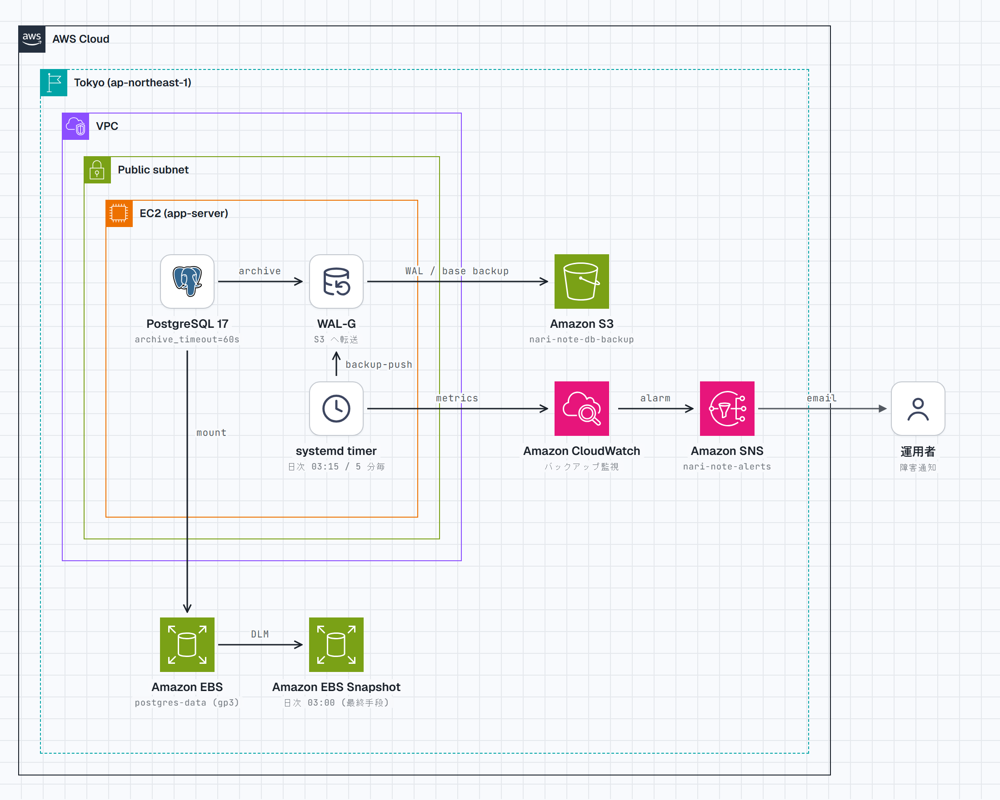
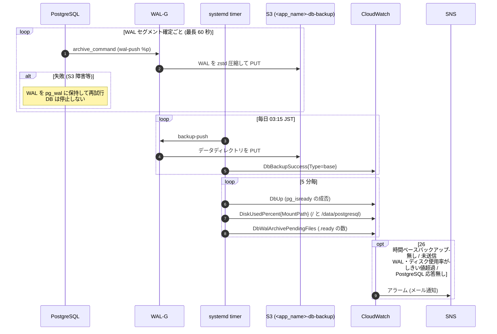
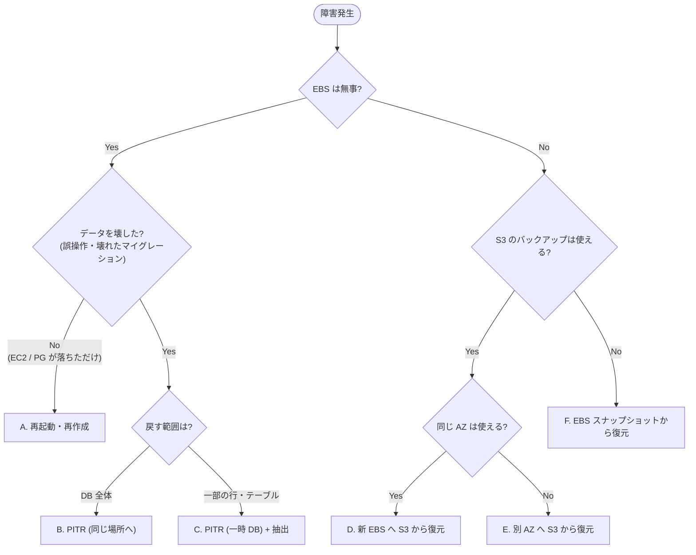
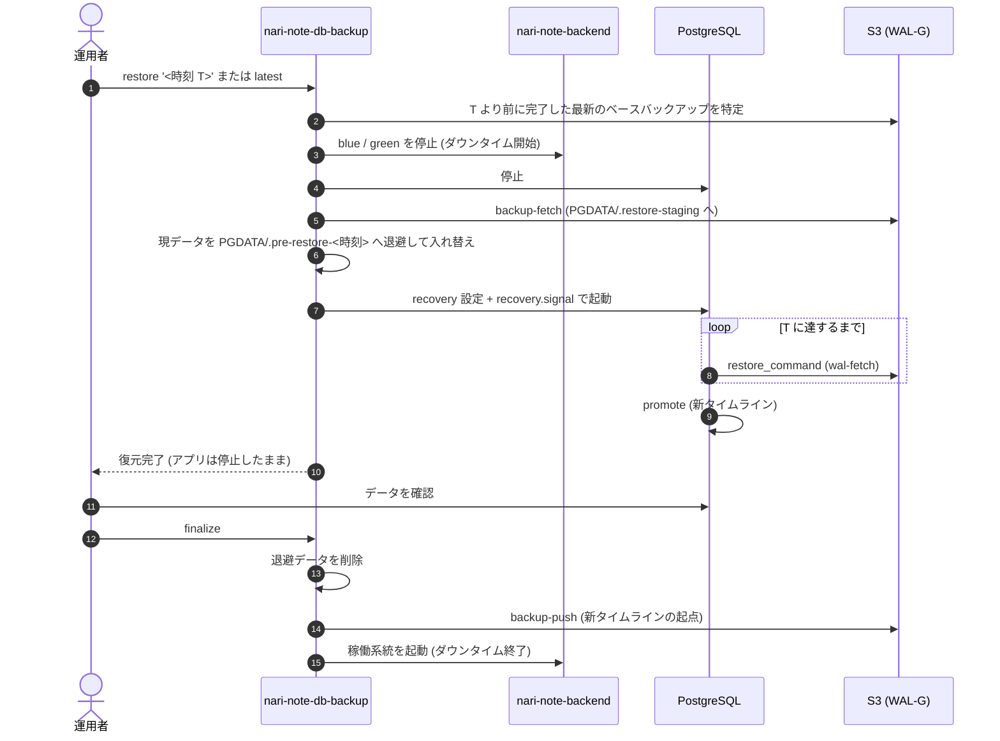

# DB バックアップ・リストア設計

> 実装: `terraform/modules/db/backup` (S3)、`terraform/modules/app/server/nari-note-db-backup.sh` (導入・バックアップ・リストア)、`terraform/modules/app/server/postgresql.conf`、`terraform/modules/app/observer` (アラーム)
>
> 障害時の作業手順は [db-restore-runbook.md](db-restore-runbook.md) を参照。

## 方針

EBS スナップショットだけでは日次 (最大 24 時間分の損失) になるため、WAL (PostgreSQL の変更ログ) を S3 へ継続的にアーカイブし、任意の時刻へ戻せる (PITR) ようにしている。

| 層 | 手段 | 役割 | RPO | 保持 |
| --- | --- | --- | --- | --- |
| PITR | WAL-G によるベースバックアップ (日次) + WAL アーカイブ (継続) を S3 へ | EBS 喪失・AZ 障害・誤操作からの時点指定復旧 | 約 1 分 | 7 日 |
| 物理スナップショット | DLM による EBS スナップショット (JST 03:00) | S3 側が使えない場合の最終手段 | 24 時間 | 日次 7 世代 + 週次 4 世代 |

- pg_dump (論理バックアップ) は定期取得しない。部分復旧は PITR で一時 DB を立てて抽出する
- WAL は差分のため、再生の起点となるベースバックアップも WAL-G で S3 に取得する
- リージョン全体の障害は対象外 (必要になればバケットのクロスリージョンレプリケーションを検討する)

## 構成

<picture>
  <source media="(prefers-color-scheme: dark)" srcset="db-backup-dark.png">
  
</picture>

### 平常時の動作



### S3 バケット (`db/backup`)

- バケット名は `<app_name>-db-backup`。バージョニング・SSE-S3・パブリックアクセスブロックを有効にする
- `wal-g/` は作成から `retention_days` (既定 8 日) で失効する。ベースバックアップは日次のため、常に 7 日以上の PITR 範囲が残る。旧バージョンは 7 日で失効
- EC2 ロールには `s3:PutObject` / `s3:GetObject` / `s3:ListBucket` のみ付与し、`s3:DeleteObject` は付与しない (乗っ取り・誤操作でバックアップを消されないため。世代削除はライフサイクルに任せる)
- 管理者の誤操作・認証情報の漏洩に備え、S3 Object Lock (GOVERNANCE) の既定の保持期間 `object_lock_days` (既定 7 日) を設定している。保持期間中のバージョンは `s3:BypassGovernanceRetention` を明示しない限り削除・上書き削除できない。ライフサイクルによる失効 (削除マーカーの付与) は保持期間中でも行われ、旧バージョンの完全削除は保持期間の経過後に行われる
- WAL-G の PUT には AWS SDK が Content-MD5 を付けるため、既定の保持期間があってもアップロードは失敗しない。WAL-G を更新したときは `wal-push` / `backup-push` が成功することを dev で確認する

### PostgreSQL / WAL-G の設定

- `modules/app/server/postgresql.conf` を userdata が `/data/postgresql/conf.d/nari-note.conf` に配置する。`archive_mode = on`、`archive_command` で WAL-G の `wal-push` を呼び、`archive_timeout = 60s` で低トラフィック時も最長 60 秒で WAL を切り替えて RPO を抑える
- WAL-G 本体・`/etc/wal-g/config.json`・systemd timer は `nari-note-db-backup install` が配置する (userdata から PostgreSQL 起動前に実行)。WAL-G はバージョンと SHA256 を固定して取得し、圧縮は zstd、`WALG_VERIFY_PAGE_CHECKSUMS` でベースバックアップ時にページ破損を検査する
- WAL-G はページ破損を検知しても `backup-push` を成功として終え、破損ブロックを S3 の `wal-g/basebackups_005/<backup_name>/files_metadata.json` (`Files.<path>.CorruptBlocks`) に記録するだけである。そのため `base` は取得後にこのファイルを確認し、破損があれば失敗として扱う (成功を記録しないため「ベースバックアップ欠落」アラームで気付ける)。破損を含むベースバックアップ自体は S3 に残る

### data checksums

ストレージ上のページ破損を読み込み時に検知するため、data checksums を有効にしている。

- 新規 initdb では userdata が `--data-checksums` を付ける。既存クラスタが無効なら、userdata が起動前に `pg_checksums --enable` を試みる (異常終了したクラスタでは失敗するため、その場合は手動で有効化する)
- 有効化前のベースバックアップから戻すと無効に戻るため、**有効化後は `sudo nari-note-db-backup base` でベースバックアップを取り直す**
- 状態は `SHOW data_checksums;`、検知件数は `SELECT datname, checksum_failures FROM pg_stat_database;` で確認する
- 読み込み時の検知件数は `check` が `DbChecksumFailures` として送り、1 件以上でアラームが出る。累計値のため、原因を調べて復旧した後に該当 DB で `SELECT pg_stat_reset();` を実行するまで発報し続ける

### 監視 (`app/observer`)

| アラーム | 条件 |
| --- | --- |
| ベースバックアップ欠落 | `DbBackupSuccess{Type=base}` が 26 時間記録されない (欠損は異常扱い)。取得したベースバックアップにページ破損がある場合も成功を記録しない |
| WAL アーカイブ滞留 | `DbWalArchivePendingFiles` がしきい値 (`wal_archive_pending_threshold`) を 2 回連続で超える |
| PostgreSQL 停止 | `DbUp` が 2 回連続で 0 (欠損は異常扱い) |
| データページ破損 | `DbChecksumFailures` (`pg_stat_database.checksum_failures` の合計) が 1 以上 |
| ディスク使用率 | `DiskUsedPercent{MountPath}` が `/`・`/data/postgresql` それぞれでしきい値 (`disk_used_percent_threshold`、既定 80%) を 2 回連続で超える (欠損は異常扱い) |
| PostgreSQL エラーログ | `/<app_name>/postgresql` の ERROR / FATAL / PANIC 件数がしきい値を超える |

- S3 障害時も DB は止まらないが、未送信の WAL が `pg_wal` に溜まりディスクを圧迫するため滞留とディスク使用率を監視する
- ルートボリューム (8GiB) は swap・dnf キャッシュ・`extract` の一時 DB 展開先を兼ねるため、データ用 EBS と別に監視する
- いずれも `nari-note-db-backup check` (5 分毎) が送る。check が止まるとすべてデータ欠損になり、各アラームが発報する
- データページ破損は PostgreSQL が停止していると送られないため、欠損を異常扱いしない (停止・check の停止は PostgreSQL 停止のアラームで検知する)
- CloudWatch の無料枠 (アラーム 10 個・カスタムメトリクス 10 個) に収めるため、接続数・トランザクション ID の周回 (`age(datfrozenxid)`) 等、現状の規模と設定 (`max_connections` / `statement_timeout` / `idle_in_transaction_session_timeout`) で起こりにくいものは監視していない。必要時は `pg_stat_activity` / `pg_database` を直接確認する
- autovacuum (1 秒以上) と一時ファイルの書き出しは `postgresql.conf` の `log_autovacuum_min_duration` / `log_temp_files` で PostgreSQL のログに出る
- アラームの無い dev では `app/server` の `enable_db_health_check = false` で check を無効にしている (スクリプトの S3 配布時に埋め込まれ、`install` が check の timer を配置しない)
- `restore` は PostgreSQL を停止するため、実行中は PostgreSQL 停止のアラームが発報する
- 最終アーカイブからの経過時間ではなく未送信数を見る (アクセスが無いと WAL が切り替わらず、経過時間は正常時でも伸びるため)
- メトリクスは `CWAgent` 名前空間に `AppName` ディメンションで送る (インスタンス再作成でアラームが外れないよう InstanceId は使わない)

## リストア

EC2 上の `nari-note-db-backup` (`list` / `restore` / `finalize` / `extract` / `extract-stop` / `base`) で行う。コマンドの使い方は runbook を参照。

### 障害ケースの判定



記号は runbook の手順 A〜F に対応する。

### restore の仕組み (手順 B / D / E)



- 退避データは PGDATA (EBS のマウントポイント) 配下に置く。ベースバックアップに含まれないよう finalize で削除する
- `extract` (手順 C) は本番を止めず、`/var/tmp/nari-note-pg-extract` に port 5433 の一時 DB を立てる。一時 DB の WAL が本番のアーカイブに混ざらないよう `archive_mode = off` で起動する

### 共通の注意事項

- **復旧後は必ず新しいベースバックアップを取得する** (finalize が行う)。PITR 後はタイムラインが分岐するため、古いベースバックアップと新しい WAL が繋がらない状態を残さない
- **アプリのバージョンと DB の時点を揃える**。マイグレーション適用前の時点へ戻した場合、新しいアプリは起動時にマイグレーションを再適用する
- **定期的にリストア訓練を行う** (月 1 回程度、dev 環境で B と C)

## 導入・更新

新しい環境に導入する場合の順序。

1. `db/backup` を apply してバケットを作成する
2. `app/server` を apply する。userdata が変わるため **EC2 が再作成される** (EBS は残る)。起動時に userdata が `nari-note-db-backup install` を実行してからアーカイブ有効の PostgreSQL を起動する
3. EC2 上で `sudo nari-note-db-backup base` を実行し、最初のベースバックアップを取る (次の 03:15 まで PITR できない状態を残さないため)
4. prod は `app/observer` を apply してアラームを作成する

`nari-note-db-backup.sh` だけを変更した場合、apply で S3 上のスクリプトは更新されるが EC2 は再作成されない。稼働中のインスタンスへは EC2 上で以下を実行して反映する (dev は `nari-note` を `nari-note-dev` に読み替える)。

```bash
sudo aws s3 cp s3://nari-note-deploy/scripts/nari-note-db-backup.sh /usr/local/bin/nari-note-db-backup --region ap-northeast-1
sudo chmod 755 /usr/local/bin/nari-note-db-backup
sudo nari-note-db-backup install nari-note nari-note-db-backup
```
