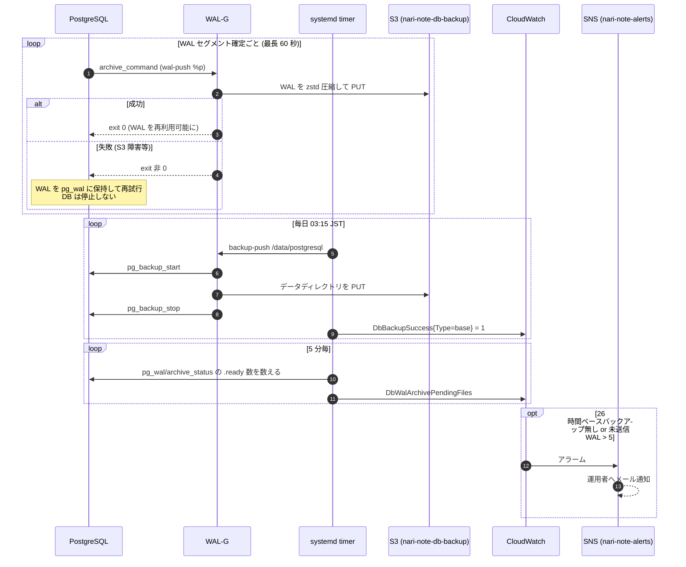
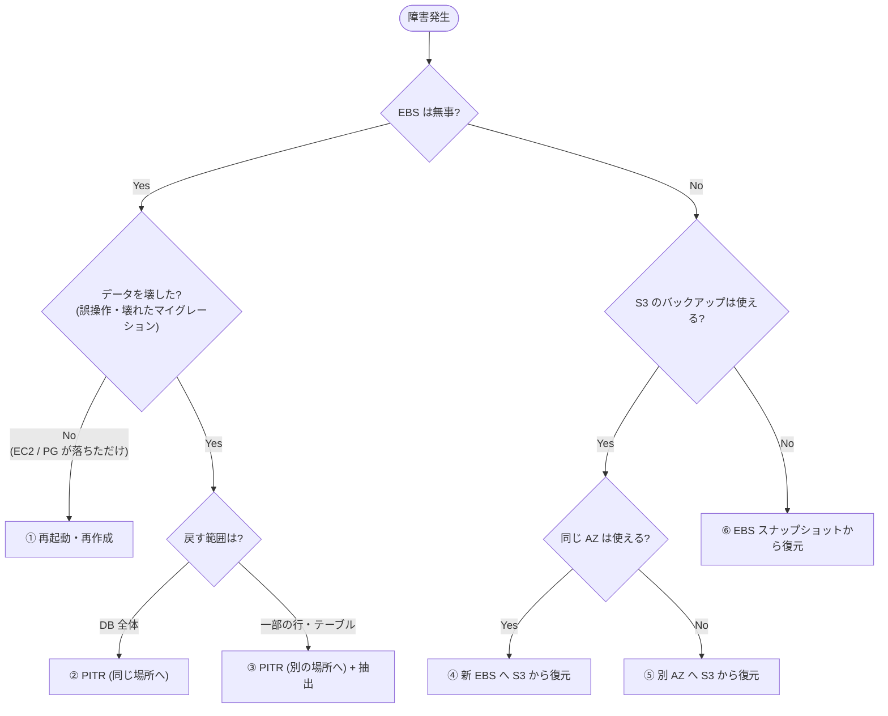
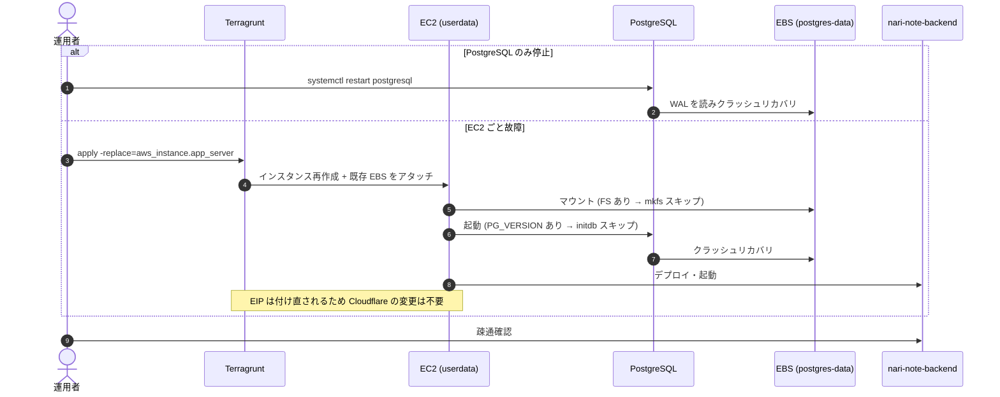
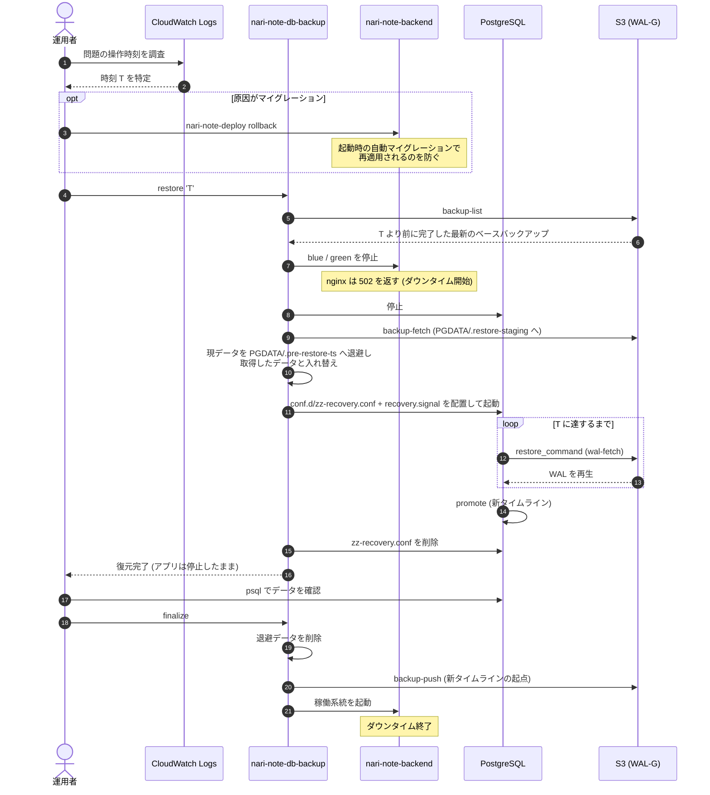
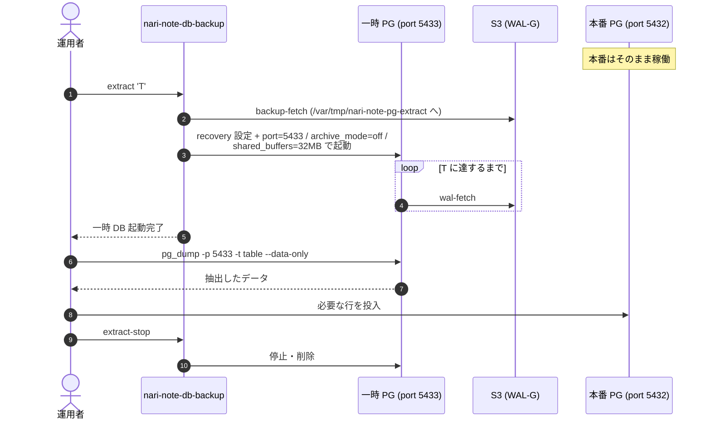
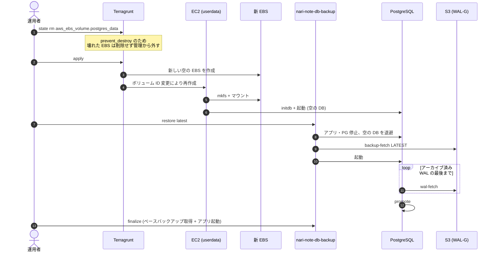
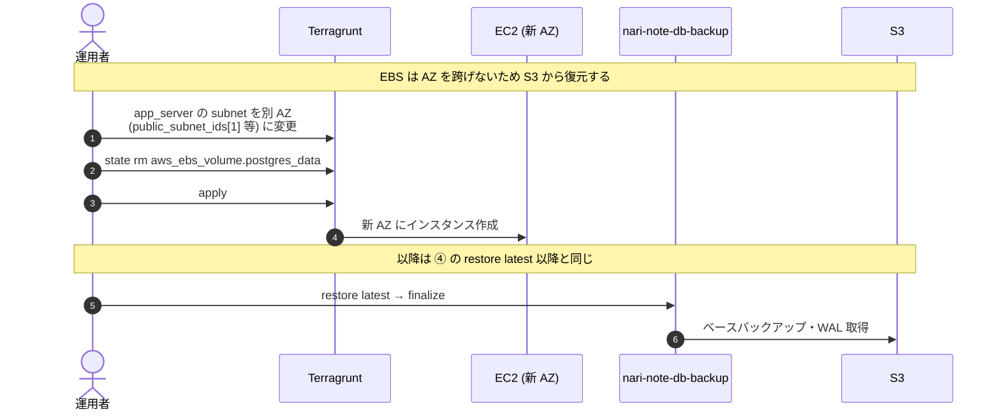
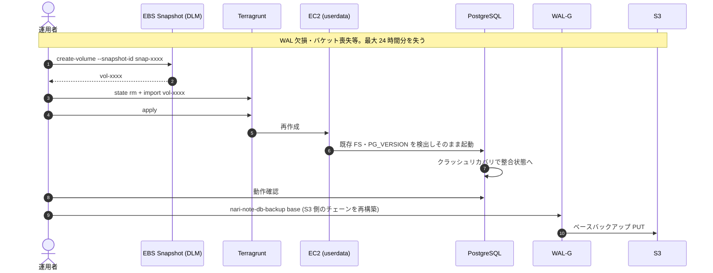

# DB バックアップ・リストア設計

> 実装: `terraform/prod/db/backup` (S3)、`terraform/prod/app/server/nari-note-db-backup.sh` (導入・バックアップ・リストア)、`terraform/prod/app/observer` (アラーム)

## 背景

EBS スナップショット (DLM) は日次 (JST 03:00) のため、EBS 喪失や誤操作の際には最大 24 時間分のデータを失う。
WAL (PostgreSQL の変更ログ) を S3 へ継続的にアーカイブし、任意の時刻へ戻せる (PITR: Point-In-Time Recovery) ようにする。

## 方針

| 層 | 手段 | 役割 | RPO | 保持 |
| --- | --- | --- | --- | --- |
| 物理スナップショット (既存) | DLM による EBS スナップショット | S3 側が使えない場合の最終手段 (別系統の保険) | 24h | 日次 7 世代 + 週次 4 世代 |
| PITR (新規) | WAL-G によるベースバックアップ (日次) + WAL アーカイブ (継続) を S3 へ | EBS 喪失・AZ 障害・誤操作からの時点指定復旧 | 約 1 分 | 7 日 |

- pg_dump (論理バックアップ) は定期取得しない。部分復旧は PITR で一時 DB を立てて抽出し、メジャーバージョンアップ等で必要な場合はその都度取得する
- WAL だけでは復元できない (差分のため)。再生の起点となるベースバックアップも WAL-G で S3 に取得する

## 構成

<picture>
  <source media="(prefers-color-scheme: dark)" srcset="db-backup-dark.png">
  
</picture>

### 平常時の動作



### S3 バケット (`prod/db/backup`)

- バージョニング・SSE-S3 (AES256)・パブリックアクセスブロックは `deploy/bucket` と同様
- ライフサイクル
  - `wal-g/`: 作成から 8 日 (`retention_days`) で失効。ベースバックアップは日次のため、常に 7 日以上の PITR 範囲が残る
  - 旧バージョン: 7 日で失効
  - 失効で残った削除マーカー・中断されたマルチパートアップロードは掃除する
- EC2 ロールには `s3:PutObject` / `s3:GetObject` / `s3:ListBucket` のみ付与し、`s3:DeleteObject` は付与しない (乗っ取り・誤操作でバックアップを消されないため。世代削除はライフサイクルに任せる)

### PostgreSQL 設定 (`postgresql.conf` へ追記)

```conf
archive_mode = on
archive_command = '/usr/local/bin/wal-g --config /etc/wal-g/config.json wal-push %p'
# 低トラフィックでは 16MB の WAL セグメントが埋まらないため、最長 60 秒で切り替えて RPO を抑える
archive_timeout = 60s
```

### WAL-G 設定 (`/etc/wal-g/config.json`)

`nari-note-db-backup install` が生成する。WAL-G は Ubuntu 20.04 向けビルド (glibc 2.31 以上で動作) を、バージョンと SHA256 を固定して GitHub Releases から取得する。

```json
{
  "WALG_S3_PREFIX": "s3://nari-note-db-backup/wal-g",
  "AWS_REGION": "ap-northeast-1",
  "WALG_COMPRESSION_METHOD": "zstd",
  "WALG_UPLOAD_CONCURRENCY": "1",
  "PGHOST": "/run/postgresql"
}
```

### 監視 (`app/observer`)

| アラーム | 条件 | 欠損データの扱い |
| --- | --- | --- |
| ベースバックアップ欠落 | `DbBackupSuccess{Type=base}` が 26 時間記録されない | breaching |
| WAL アーカイブ滞留 | `DbWalArchivePendingFiles > 5` が 2 回連続 (5 分毎) | breaching |

- S3 障害時も DB は停止しないが、未送信の WAL が `pg_wal` に溜まりディスクを圧迫するため滞留を監視する
- 最終アーカイブ時刻からの経過時間ではなく未送信数を見る。アクセスが無いと WAL が切り替わらず、経過時間は正常時でも伸び続けるため
- メトリクスは `CWAgent` 名前空間に `AppName` ディメンションで送る (インスタンス再作成でアラームが外れないよう InstanceId は使わない)

## リストア

リストアは EC2 上の `nari-note-db-backup` で行う。実際の作業手順は [db-restore-runbook.md](db-restore-runbook.md) を参照。

| コマンド | 内容 |
| --- | --- |
| `sudo nari-note-db-backup list` | S3 上のベースバックアップ一覧 |
| `sudo nari-note-db-backup restore <latest\|時刻>` | アプリ・PG を止めて S3 から復元する。時刻はオフセット付きで指定する (例: `'2026-11-05 14:31:00+09:00'`)。アプリは停止したまま |
| `sudo nari-note-db-backup finalize` | restore 後の確認が済んだら実行する。退避データ削除 → ベースバックアップ取得 → アプリ起動 |
| `sudo nari-note-db-backup extract <時刻>` | 本番を止めずに、指定時刻の DB を port 5433 で一時起動する |
| `sudo nari-note-db-backup extract-stop` | 一時 DB を停止・削除する |

### 障害ケースの判定



| # | ケース | RPO (失うデータ) | RTO 目安 | 使うもの |
| --- | --- | --- | --- | --- |
| ① | EC2 / PG 障害 | なし | 数分 | 既存 EBS |
| ② | DB 全体を時刻 T へ | T 以降 (意図的に破棄) | 10〜20 分 | WAL-G |
| ③ | 一部だけ戻す | なし | 20〜30 分 | WAL-G |
| ④ | EBS 喪失 | 最大約 1 分 | 20〜30 分 | WAL-G |
| ⑤ | AZ 障害 | 最大約 1 分 | 30 分〜 | WAL-G |
| ⑥ | S3 側も使用不可 | 最大 24 時間 | 20〜30 分 | DLM スナップショット |

リージョン全体の障害は対象外 (必要になればバケットのクロスリージョンレプリケーションを検討する)。

### ① EC2 / PostgreSQL 障害 (EBS 無事)



### ② DB 全体を時刻 T へ戻す (PITR)

時刻 T は CloudWatch Logs (`/nari-note/application`, `/nari-note/nginx/access`) から問題の操作・マイグレーションの時刻を特定し、その直前とする。



- 退避データは PGDATA 配下に置く (PGDATA は EBS のマウントポイントそのものであり、ディレクトリごと移動できないため)。ベースバックアップに含まれないよう finalize で削除する
- 復元に失敗した場合はアプリを停止したまま終了する。退避データから手動で戻すか、別の時刻で再実行する

### ③ 一部の行・テーブルだけ戻す (本番無停止)



- `archive_mode = off` は、一時 DB の WAL が本番のアーカイブに混ざらないようにするため
- 一時 DB はルートボリューム (8GiB) に展開する。DB が大きくなった場合は容量に注意する

### ④ EBS 喪失



空の DB とアプリが一時的に起動してしまう点は、復元用の userdata フラグを設けて改善する余地がある。

### ⑤ AZ 障害



### ⑥ S3 のバックアップが使えない (最終手段)



## 共通の注意事項

- **復旧後は必ず新しいベースバックアップを取得する** (finalize が行う)。PITR 後はタイムラインが分岐するため、古いベースバックアップと新しい WAL が繋がらない状態を残さない
- **アプリのバージョンと DB の時点を揃える**。マイグレーション適用前の時点へ戻した場合、新しいアプリは起動時にマイグレーションを再適用する
- **定期的にリストア訓練を行う**。月 1 回程度、② と ③ を dev 環境で実施する

## 導入手順

1. `terragrunt apply` (`prod/db/backup`): バケットを作成する
2. `terragrunt apply` (`prod/app/server`): userdata の変更により **EC2 が再作成される** (EBS は残るためデータは失われないが、数分停止する)。起動時に userdata が `nari-note-db-backup install` を実行し、WAL-G・設定・timer を配置してから、アーカイブを有効にした PostgreSQL を起動する
3. EC2 上で `sudo nari-note-db-backup base` を実行し、最初のベースバックアップを取る (次の 03:15 まで PITR できない状態を残さないため)
4. `terragrunt apply` (`prod/app/observer`): アラームを作成する
5. dev も同様に `dev/db/backup` → `dev/app/server` の順に apply する (リストア訓練に使う)

### スクリプトだけを更新する場合

`nari-note-db-backup.sh` を変更しても EC2 は再作成されない (S3 上のオブジェクトだけが更新される)。稼働中のインスタンスへは以下で反映する。

```bash
sudo aws s3 cp s3://nari-note-deploy/scripts/nari-note-db-backup.sh /usr/local/bin/nari-note-db-backup --region ap-northeast-1
sudo chmod 755 /usr/local/bin/nari-note-db-backup
sudo nari-note-db-backup install nari-note nari-note-db-backup
```
