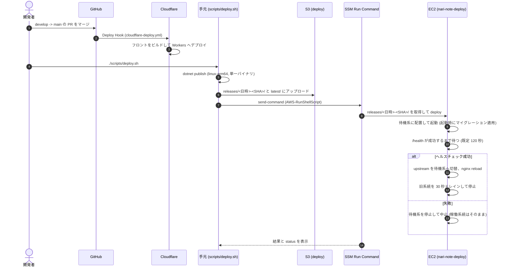

# インフラ設計

本番 (prod) のシステム構成、Terraform / Terragrunt の構成方針、デプロイとリリースの流れをまとめる。
リソースの正は `infrastruture/terraform/modules/`、Terraform の規約は [../AGENTS.md](../AGENTS.md) を参照。

## システム構成

<picture>
  <source media="(prefers-color-scheme: dark)" srcset="nari-note-infra-dark.png">
  
</picture>

- フロントは Cloudflare Workers で動き、クライアントからの API 呼び出しは Next.js の BFF (`app/api/[...path]`) を経由してバックエンド (`API_URL`、`wrangler.toml`) へ送る
- `api.nari-note.com` は Cloudflare のプロキシ経由で EC2 の EIP に届く。nginx は Cloudflare Origin 証明書 (SSM から取得) で TLS を終端する
- バックエンド・PostgreSQL・nginx は 1 台の EC2 (Amazon Linux 2023 / arm64) に同居する。DB データは専用の EBS に置き、EC2 を作り直してもデータは残る
- SSH は開けない。運用操作は SSM (Session Manager / Run Command) で行う
- 秘匿値 (JWT・DB 接続・外部 API キー等) は SSM Parameter Store の `/<app_name>/...` に置き、Terraform で投入する
- 画像は S3 (`<app_name>-images`) に保存し、CloudFront (OAC) で配信する
- DB のバックアップは WAL-G による S3 への継続アーカイブ + DLM の EBS スナップショット。詳細は [db-backup-recovery.md](db-backup-recovery.md)
- 監視は CloudWatch (ログ・アラーム) → SNS でメール通知 (`app/logger`, `app/observer`)。コストは `budget` で月額予算アラートを設定している

## Terraform / Terragrunt の構成方針

| 項目 | 方針 |
| --- | --- |
| 環境分割 | `terraform/prod/`・`terraform/dev/` をディレクトリで分ける。差は `root.hcl` の `env_name` / `app_name` (`nari-note` / `nari-note-dev`) のみ。dev は prod の一部ユニットだけを持つ (リストア訓練等に使う) |
| モジュール | リソース定義は `modules/<group>/<unit>/` に置き、環境側は `terragrunt.hcl` で参照するだけにする。環境差分は `inputs` / `terraform.tfvars` で渡す |
| ユニット粒度 | `network/vpc` `app/server` `db/backup` のように役割ごとに state を分け、ユニット間は `terraform_remote_state` で参照する。依存順は各 `terragrunt.hcl` の `dependencies` に書く |
| state | S3 バケット `nari-note-terraform` に `<env_name>/<group>/<unit>/terraform.tfstate` で保存し、S3 のネイティブロック (`use_lockfile`) を使う |
| state バケット自身 | `terraform/backend/` (素の Terraform) で作成し、その tfstate だけは例外的に Git 管理する |
| 生成ファイル | `backend.tf` / `provider.tf` / `terraform.tf` は `root.hcl` が `terragrunt-template/` から生成する。Terraform・AWS プロバイダのバージョンは `root.hcl` で固定する |
| 秘匿値 | 各ユニットの `terraform.tfvars` に置き、Git 管理しない (`infrastruture/.gitignore`) |
| ツールのバージョン | `.terraform-version` / `.terragrunt-version` (tenv が参照) |

## デプロイとリリース

ブランチは `develop` (デフォルト) で開発し、リリース時に `develop` → `main` の PR をマージする。

| 対象 | トリガー | 仕組み |
| --- | --- | --- |
| フロント | `main` への PR マージ | `.github/workflows/cloudflare-deploy.yml` が Cloudflare の Deploy Hook を叩き、Cloudflare 側でビルド・デプロイする |
| バックエンド | 手動 | 手元からリリース対象のコミットで `scripts/deploy.sh` を実行する (CI からは自動デプロイしない) |
| インフラ | 手動 | 対象ユニットで `terragrunt plan` / `apply` |

GitHub Actions は PR 時のチェック (Backend Build / Test, Frontend Check) とフロントのデプロイのみを行う。
手元でフロントをデプロイ・確認する場合は `nari-note-frontend` で `npm run deploy` / `npm run preview` (OpenNext でビルドして wrangler で実行) を使う。



### Blue/Green

同一 EC2 上で blue / green の 2 系統を systemd テンプレートユニット `nari-note-backend@{blue,green}` (ポート 5001 / 5002) として持ち、nginx の upstream を切り替えて無停止デプロイする。

- nginx の向き先 `/etc/nginx/nari-note-backend/active-upstream.conf` は EC2 上の `nari-note-deploy` (`modules/app/server/nari-note-deploy.sh`) だけが書き換える
- メモリ節約のため、切替時以外は 1 系統だけを動かす。切替中の一時的なメモリ使用量は約 2 倍になる
- `deploy.sh` は毎回リポジトリの `nari-note-deploy.sh` をリリースに含めて上書きする。`latest/` はインスタンス再作成時に userdata が取得する
- 対象インスタンスは Name タグ `<APP_NAME>-app-server` の稼働中インスタンス。dev や特定インスタンスを対象にするには `scripts/.env` (`scripts/.env.example` 参照) で `APP_NAME` / `EC2_INSTANCE_ID` を指定する。AWS 認証は aws-vault のプロファイル (`AWS_VAULT_PROFILE`、既定 `narinote`)

### ロールバック

旧系統のバイナリは次回デプロイまで残るため、直前のバージョンへ戻せる。

```bash
./scripts/rollback.sh
# EC2 上で直接行う場合 (Session Manager で接続)
sudo nari-note-deploy rollback
sudo nari-note-deploy status
```

### マイグレーションの注意

- 新旧 2 系統が同じ DB を共有し、新系統は起動時にマイグレーションを適用する。切替中は旧バージョンも新スキーマで動くため、マイグレーションは後方互換 (expand / contract) にする
- 後方互換でないマイグレーションを含むリリースはロールバックできない
