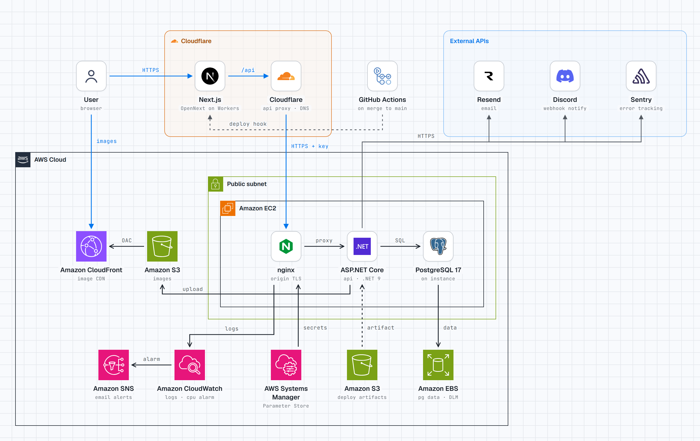
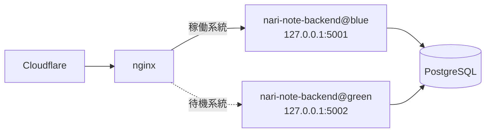

# インフラ設計

## 概要図

<picture>
  <source media="(prefers-color-scheme: dark)" srcset="nari-note-infra-dark.png">
  
</picture>

## 各サービス設定

### VPC

### EC2

### RDS

### Redis

### S3

### CloudWatch

## デプロイ (Blue/Green)

API サーバー (EC2) では、同一インスタンス上で blue / green の 2 系統を動かし、nginx の upstream を切り替えることで無停止デプロイを行う。



| 項目 | blue | green |
| --- | --- | --- |
| systemd ユニット | `nari-note-backend@blue` | `nari-note-backend@green` |
| ポート | 5001 | 5002 |
| 配置先 | `/opt/nari-note-backend/blue` | `/opt/nari-note-backend/green` |
| アプリログ | `/var/log/nari-note-backend/app-blue*.log` | `/var/log/nari-note-backend/app-green*.log` |

- nginx の向き先は `/etc/nginx/nari-note-backend/active-upstream.conf` で管理し、`nari-note-deploy` (`app/server/nari-note-deploy.sh`) だけが書き換える
- 系統ごとのポート・ログ出力先は `/etc/nari-note-backend/{blue,green}.env` に置く

### デプロイの流れ (`scripts/deploy.sh`)

1. ビルドしたバイナリを S3 にアップロード
2. EC2 上で `nari-note-deploy deploy` を実行
   1. 待機系にバイナリ・設定を配置して起動
   2. `/health` が成功するまで待機 (既定 120 秒)。失敗したら待機系を止めて中止し、稼働系統はそのまま
   3. upstream を待機系に書き換えて nginx を reload (処理中のリクエストは旧ワーカーが捌き切る)
   4. 旧系統を 30 秒ドレインしてから停止 (メモリ節約のため常時 2 系統は動かさない)

### ロールバック

旧系統のバイナリは次回デプロイまで残っているため、以下で直前のバージョンへ戻せる。

```bash
EC2_HOST=x.x.x.x ./scripts/rollback.sh
# EC2 上で直接行う場合
sudo /usr/local/bin/nari-note-deploy rollback
sudo /usr/local/bin/nari-note-deploy status
```

### 注意点

- 新旧 2 系統が同じ DB を共有し、新系統は起動時にマイグレーションを適用する。切り替え中は旧バージョンも新スキーマで動くため、マイグレーションは後方互換 (カラム追加 → 次リリースで旧カラム削除 等の expand/contract) にすること。また、後方互換でないマイグレーションを含むリリースはロールバックできない
- 切り替え直後〜ドレイン完了までは 2 系統が同時に動くため、一時的にメモリ使用量が約 2 倍になる
- デプロイスクリプトは Terraform が S3 (`<app_name>-deploy/scripts/nari-note-deploy.sh`) に配置し、インスタンス初回起動時に userdata が取得する。以降は `scripts/deploy.sh` が毎回リポジトリの最新版で上書きする
