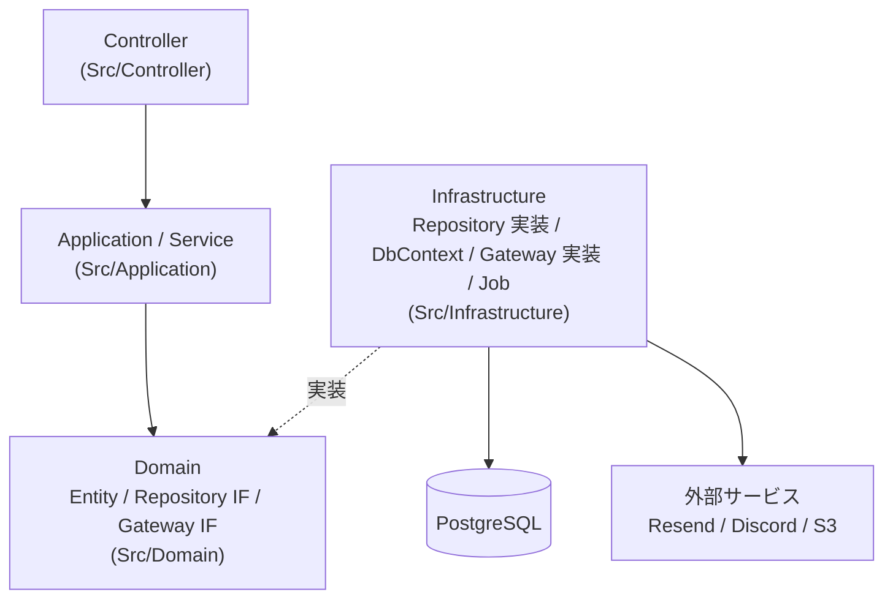
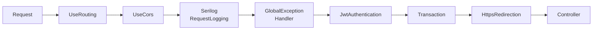
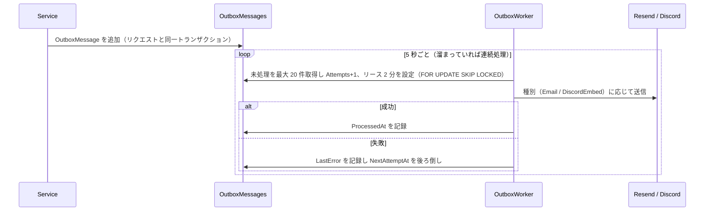

# アーキテクチャ

バックエンド（ASP.NET Core Web API）の構成・リクエスト処理・エラーハンドリング・バックグラウンドジョブの設計をまとめる。技術スタックはルートの [AGENTS.md](../../AGENTS.md) を参照。

## 設計方針

個人開発・小規模・モノリシックという前提に対し、インフラ構成（キャッシュ、DB 配置など）は変わりうる。完全なクリーンアーキテクチャは過剰なため、**階層型アーキテクチャにデータアクセス部分のみ依存性逆転を適用**している。

- Service はビジネスロジックに専念し、キャッシュ等のインフラ関心事は Repository 実装で吸収する
- **API 一個につき Service 一個**。責務が明確になり、Service 単位で単体テストできる
- トランザクションと例外→HTTP ステータス変換はミドルウェアで一元化し、Controller / Service に try-catch やトランザクション管理を書かない

## レイヤー構成



| 層 | 担うこと | 担わないこと |
|---|---|---|
| Controller | ルーティング、`[Auth]` による認証レベル指定、`[ValidateModelState]` による入力検証、Service 呼び出し | ビジネスロジック、try-catch |
| Application | Service（ユースケース）、Request/Response DTO、カスタム例外、Helper | DB・外部 API の直接操作 |
| Domain | Entity とドメインロジック、Repository / Gateway の interface、ID の ValueObject、ReadModel（一覧用の射影） | 永続化の実装 |
| Infrastructure | EF Core DbContext（`Infrastructure/Database`）、Repository 実装、外部サービスの Gateway、バックグラウンドジョブ、ValueObject のバインド・JSON 変換 | ビジネス判断 |

DI 登録は `Src/Application/ApplicationServiceInstaller.cs`（Service）と `Src/Infrastructure/InfrastructureServiceInstaller.cs`（DbContext・Repository・Gateway・Job）に集約し、`Program.cs` から呼び出す。

## リクエストパイプライン

`Program.cs` で登録しているミドルウェアの順序:



| ミドルウェア | 役割 |
|---|---|
| `UseRouting` | 先頭に置き、後続がエンドポイントのメタデータ（`[Auth]` / `[NoTransaction]`）を参照できるようにする |
| `GlobalExceptionHandlerMiddleware` | 後続で発生した例外を捕捉し、ログ・Sentry 送信のうえ `ErrorResponse` に変換する |
| `JwtAuthenticationMiddleware` | Cookie の JWT を検証し、`[Auth]` のレベルに応じて通過・拒否する。詳細は [authentication-strategy.md](./authentication-strategy.md) |
| `TransactionMiddleware` | GET / HEAD 以外のリクエスト全体を 1 つの DB トランザクションで包み、例外時はロールバックする。1 秒以上かかったトランザクションは Warning ログを出す |

- トランザクションを張りたくないエンドポイント（外部ストレージへのアップロード・削除を伴うもの等）には `[NoTransaction]` を付ける
- リクエスト単位でトランザクションを張るため、EF Core の `EnableRetryOnFailure` は使用しない
- ヘルスチェック `/health` は認証不要（`AuthLevel.Anonymous`）

## エラーハンドリング

Service や Repository は適切な例外を throw するだけでよい。`GlobalExceptionHandlerMiddleware` が以下のように HTTP ステータスへ変換する（正は同ミドルウェアの実装）。

| 例外 | ステータス | 主な用途 |
|---|---|---|
| `ArgumentException`（`ArgumentNullException` / `ArgumentOutOfRangeException` を含む）、`System.ComponentModel.DataAnnotations.ValidationException`、`InvalidOperationException` | 400 | 入力不正、ビジネスルール違反、無効・期限切れトークン |
| `UnauthorizedAccessException` | 401 | 認証エラー |
| `ForbiddenException` | 403 | 認証済みだが操作権限が無い（他人の記事の編集等） |
| `KeyNotFoundException` | 404 | リソースが存在しない（`FindForce*Async` が throw） |
| `ConflictException` | 409 | 一意制約に当たる重複（ユーザー名等）、状態の競合 |
| `TooManyRequestsException` | 429 | 送信間隔の制限 |
| `TimeoutException` | 408 | タイムアウト |
| `NariNoteException`、その他すべて | 500 | 想定外のエラー |

カスタム例外は `Src/Application/Exception/` の `ConflictException` / `ForbiddenException` / `TooManyRequestsException` / `NariNoteException` のみ。404 は専用の例外を作らず `KeyNotFoundException` を使う。

### エラーレスポンス形式

例外ハンドラーが返す形式（`ErrorResponse`、camelCase で出力）:

```json
{ "statusCode": 404, "message": "...", "timeStamp": "2026-01-01T00:00:00Z", "code": null }
```

- 500 のときは `message` を固定文言にし、例外メッセージ（内部情報）を返さない。それ以外は例外メッセージをそのまま返すため、**ユーザーに見せてよい日本語で書く**
- `code` はクライアントがエラー種別で分岐する必要がある場合のみ設定する（`ErrorCode` 定数。例: `EMAIL_NOT_VERIFIED`）

例外ハンドラーを通らないエラー応答もある:

- `[ValidateModelState]` による入力検証エラー: 400 で `{ "errors": { "<項目名>": ["メッセージ", ...] } }`
- `JwtAuthenticationMiddleware` の 401: `{ "error": { "code": "UNAUTHORIZED", "message", "timestamp", "path" } }`
- 同ミドルウェアのメール未認証による 403: `ErrorResponse` 形式で `code` = `EMAIL_NOT_VERIFIED`

## バックグラウンドジョブ

`Src/Infrastructure/Job/` に `BackgroundService` として実装し、Worker（定期実行）と Processor（1 回分の処理。テストから直接呼べる）に分けている。

### Outbox によるメール・Discord 通知の配送

メール送信や Discord 通知はリクエスト処理中に直接行わず、Service が `OutboxMessage` を DB に追加するだけにする。リクエストのトランザクションと同時にコミットされるため、「DB 更新はロールバックされたのにメールだけ送られた」「外部 API 障害でリクエスト自体が失敗した」を防げる。



- 取得時に `NextAttemptAt` をリース期限まで進めるため、処理中にプロセスが落ちてもリース切れ後に再取得される。`SKIP LOCKED` により複数インスタンスでも二重取得しない
- 再試行間隔は `OutboxRetryPolicy`（現状は暫定の固定 1 分）。`MaxAttempts`（5 回）に達すると `FailedAt` を記録して以後は再試行しない
- ポーリングの SQL ログは Serilog フィルタで Warning 未満を出力しない

### 未認証ユーザーの削除

`UnverifiedUserDeletionWorker` が 1 日ごとに、作成から 7 日経ってもメール認証が完了していないユーザーを削除する（他人のメールアドレスで登録されたアカウントが名前・アドレスを占有し続けないようにするため）。有効期限内の確認トークンが残っているユーザーは対象外。判定と削除は 1 つの DELETE で行い、関連データは Cascade で消える。

## 起動時の処理

- 全環境でマイグレーションを起動時に適用する（`statement_timeout` を無効化して実行）
- Development 環境のみシードデータ（`DataSeeder` / `BulkDataSeeder`）を投入する
- 設定の読み込み元は [development-workflow.md](./development-workflow.md#設定キー) を参照
