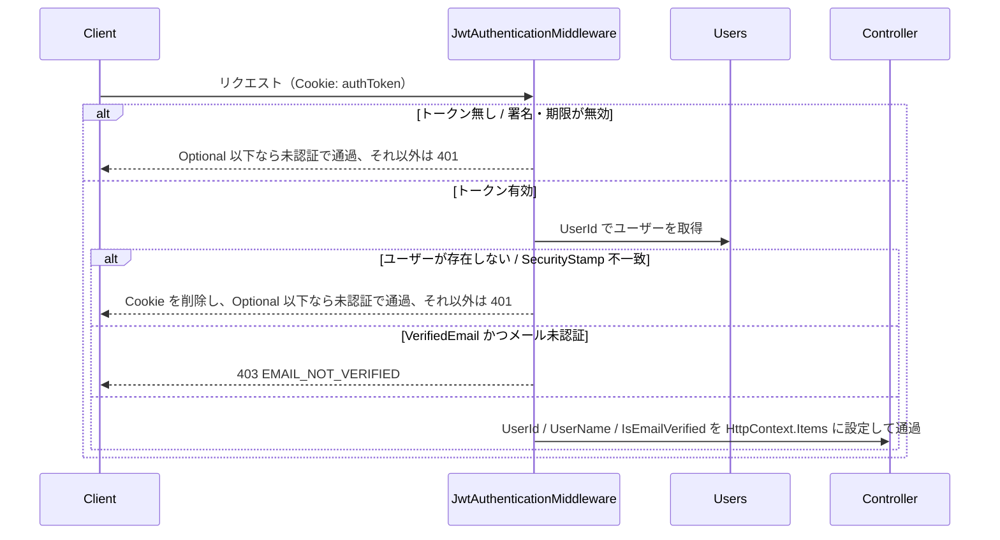
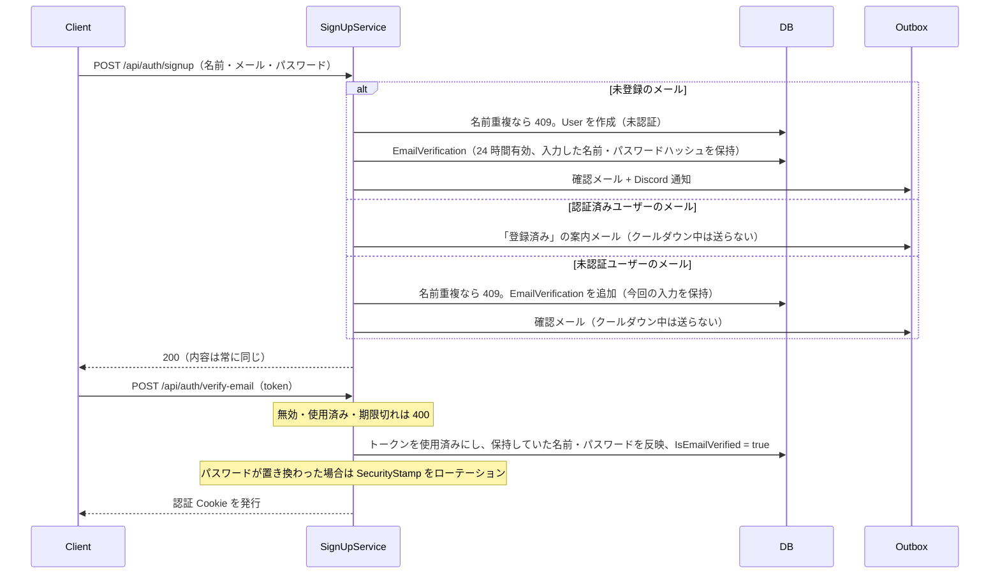
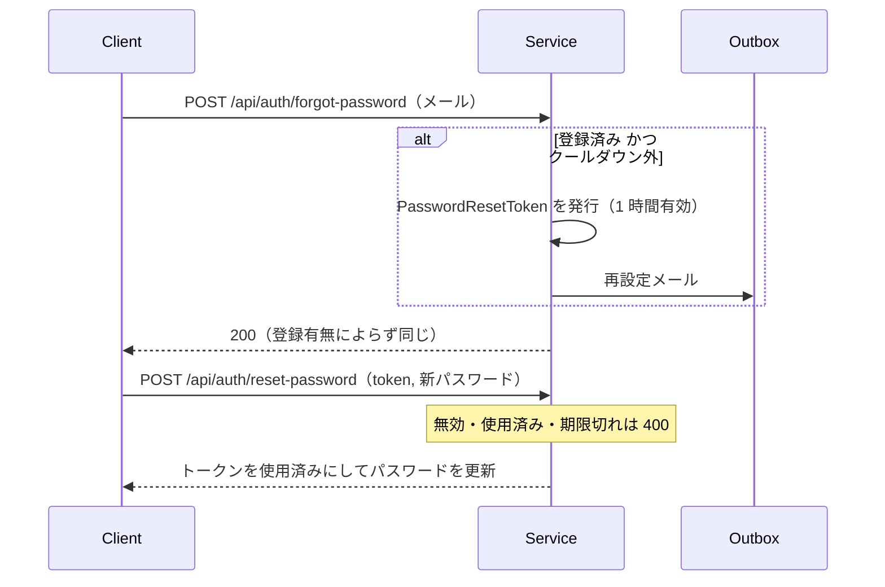

# 認証

認証まわり（JWT、メール認証、パスワード再設定、トークン失効）の設計をまとめる。エンドポイントの正は `Src/Controller/AuthController.cs`。

## 方針

- **JWT を HttpOnly Cookie（`authToken`）に保存する**。JavaScript からトークンを読めないため XSS で盗まれにくい。localStorage は使わない
- サーバー側にセッションストアを持たない。リフレッシュトークンも無く、有効期限（`Jwt:ExpirationInHours`）が切れたら再サインインする
- 即時失効が必要な場面は、ユーザーごとの **SecurityStamp** で発行済みトークンを一括無効化する
- フロントエンドは BFF プロキシ（Next.js の `app/api/[...path]`）経由で API を呼ぶため、Cookie はフロントと同一オリジンで扱われる

### Cookie の属性

| 属性 | 値 |
|---|---|
| HttpOnly | 常に有効 |
| Secure | Development 以外で有効 |
| SameSite | Development は `Lax`、それ以外は `Strict`（CSRF 対策） |
| MaxAge | JWT の有効期限と同じ |
| Path | `/` |

### JWT の内容

HS256 署名。`sub`（UserId）、`name`（ユーザー名）、`jti`、`security_stamp`（ユーザーに SecurityStamp がある場合のみ）を含む。Issuer / Audience / 有効期限を検証し、時計のずれ（ClockSkew）は許容しない。有効期限の判定には DI した `TimeProvider` を使う。

## 認証レベル

各エンドポイントに `[Auth(AuthLevel.X)]` を付ける。付けない場合は `Authenticated` として扱われる。

| レベル | トークン無し・無効 | 有効なトークン |
|---|---|---|
| `Anonymous` | 通過 | 通過（ユーザー情報を設定） |
| `Optional` | 通過（`UserId` は null） | 通過（ユーザー情報を設定） |
| `Authenticated` | 401 | 通過 |
| `VerifiedEmail` | 401 | メール未認証なら 403（`code: EMAIL_NOT_VERIFIED`）、認証済みなら通過 |

Controller は `ApplicationController` の `UserId` / `UserName` / `IsEmailVerified` で認証済みユーザーを参照する。記事・講座の作成/更新/削除、画像アップロード、いいね、コメント、フォローなどの書き込み系は `VerifiedEmail`、メール未認証でも使えるべきもの（自分の記事・下書きの取得、確認メール再送、パスワード変更、退会など）は `Authenticated` にしている。

### ミドルウェアでの検証

## SecurityStamp によるトークン失効

`User.SecurityStamp` と同じ値を JWT の `security_stamp` に埋め込み、ミドルウェアで照合する。`User.RotateSecurityStamp()` で値を変えると、それ以前に発行したトークンはすべて無効になる。

- `SecurityStamp` が null のユーザーは照合しない（導入前に発行したトークンを無効にしないため）
- 現在ローテーションするのは、メール認証時にサインアップ入力のパスワードへ置き換わった場合（下記）

## サインアップとメール認証

ユーザー列挙を防ぐため、サインアップはメールアドレスの登録有無によらず同じレスポンスを返す。名前・パスワードは「確認メールを受け取った本人」が認証した時点で確定させる。

- 未認証のままでもサインインはできる（`VerifiedEmail` のエンドポイントは 403 になる）。メール認証が済むとフロントは書き込み系を使えるようになる
- 認証時のパスワード置き換えで SecurityStamp を回すのは、メールアドレスの持ち主ではない人が先に登録・サインインしていた場合にそのセッションを切るため
- 名前は、サインアップ後に他人が同じ名前を使い始めていたら反映しない
- 確認メールの再送（`POST /api/auth/resend-verification`、`Authenticated`）は既存トークンを失効させずに新しいトークンを発行する。認証済みなら 409、クールダウン中は 429
- 7 日経っても未認証のユーザーはバックグラウンドジョブで削除される（[architecture.md](./architecture.md#未認証ユーザーの削除)）

## サインイン・サインアウト・退会

- サインイン（`POST /api/auth/signin`）: ユーザー名またはメールアドレスとパスワードで照合（BCrypt）。失敗時はどちらが誤りか区別しない 400
- 現在のユーザー（`GET /api/auth/me`、`Optional`）: ミドルウェアが設定した情報を返す
- サインアウト（`POST /api/auth/logout`）: Cookie を削除するだけで、SecurityStamp は回さない
- 退会（`POST /api/auth/withdraw`）: パスワードを再確認してユーザーを削除する。関連データは DB の Cascade で削除し、アイコン画像は DB 削除の後に外部ストレージから消す（`[NoTransaction]`）

## パスワード

- ハッシュは BCrypt.Net-Next
- 変更（`PUT /api/auth/password`、`Authenticated`）: 現在のパスワードを確認して更新
- 再設定:

## 認証メールの送信クールダウン

他人のメールアドレスを指定した API 連打で大量のメールが届くのを防ぐため、同じユーザーへの認証系メール（確認メール・登録済みの案内・パスワード再設定）は直前の送信から 60 秒間送らない（`AuthEmailCooldown`）。

| 操作 | クールダウンの基準 | クールダウン中の挙動 |
|---|---|---|
| サインアップ（未認証ユーザー） | 最新の EmailVerification の作成日時 | 送信だけ止めて 200（登録有無を漏らさない） |
| サインアップ（認証済みユーザー） | `User.AlreadyRegisteredNotifiedAt` | 同上 |
| パスワード再設定の申請 | 最新の PasswordResetToken の作成日時 | 同上 |
| 確認メールの再送 | 最新の EmailVerification の作成日時 | 429（本人の操作なので明示する） |

メールはすべて Outbox 経由で非同期に送られる（[architecture.md](./architecture.md#outbox-によるメールdiscord-通知の配送)）。
