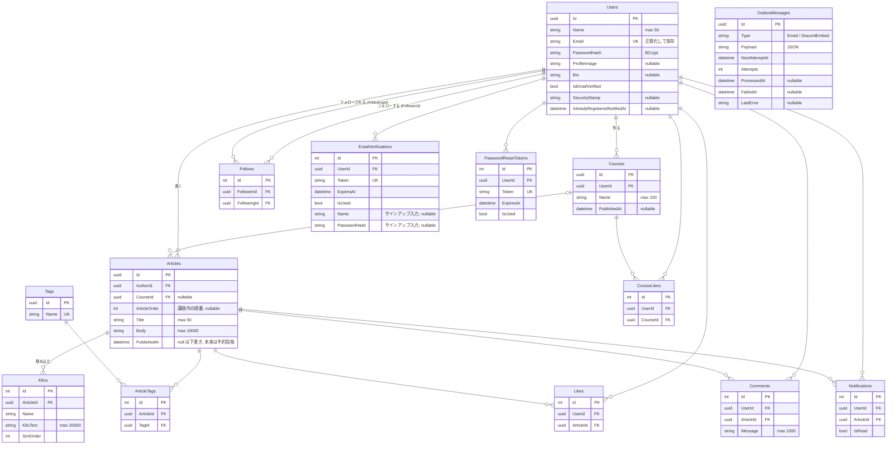

# ER 図

主要カラムのみを示す。スキーマの正は `Migrations/NariNoteDbContextModelSnapshot.cs`（Entity は `Src/Domain/Entity/`、リレーション設定は `Src/Infrastructure/Database/NariNoteDbContext.cs`）。

## 補足

- 全テーブルに `CreatedAt` / `UpdatedAt` がある（`EntityBase`。未設定なら保存時に `NariNoteDbContext` が設定する）
- ID は Vogen の ValueObject（`UserId` 等）。Users / Articles / Courses / Tags は UUID v7 をアプリ側で採番し、それ以外は int の IDENTITY 列
- 外部キーはすべて `ON DELETE CASCADE`。ユーザー削除（退会・未認証ユーザー削除）で記事・講座・いいね・コメント・フォロー・通知・各種トークンがまとめて消え、講座を削除すると所属する記事も消える
- 一意制約: `Users.Email`（`lower(Email)`）、`Users.Name`、`Tags.Name`、`EmailVerifications.Token`、`PasswordResetTokens.Token`、`(ArticleId, TagId)`、`(UserId, ArticleId)` の Likes、`(UserId, CourseId)` の CourseLikes、`(FollowerId, FollowingId)` の Follows
- `OutboxMessages` は他テーブルと関連を持たない配送キュー（[architecture.md](./architecture.md#バックグラウンドジョブ)）
