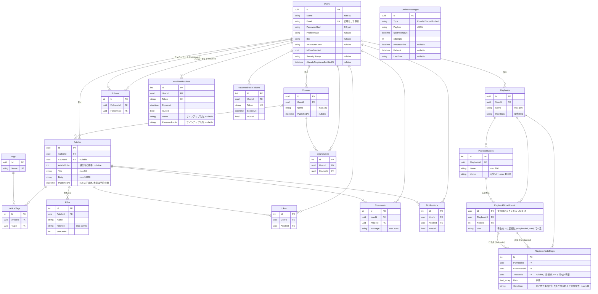

# ER 図

主要カラムのみを示す。スキーマの正は `Migrations/NariNoteDbContextModelSnapshot.cs`（Entity は `Src/Domain/Entity/`、リレーション設定は `Src/Infrastructure/Database/NariNoteDbContext.cs`）。

## 補足

- 全テーブルに `CreatedAt` / `UpdatedAt` がある（`EntityBase`。未設定なら保存時に `NariNoteDbContext` が設定する）
- ID は Vogen の ValueObject（`UserId` 等）。Users / Articles / Courses / Tags / Playbooks / PlaybookNodeBoards は UUID v7 をアプリ側で採番し、それ以外は int の IDENTITY 列。PlaybookNodeBoards は同じミリ秒の中でも登録順に大きくなるよう採番する
- 外部キーは `PlaybookNodeBoards.NodeId`（`NO ACTION`）以外すべて `ON DELETE CASCADE`。ユーザー削除（退会・未認証ユーザー削除）で記事・講座・いいね・コメント・フォロー・通知・各種トークンがまとめて消え、講座を削除すると所属する記事も消える
- 一意制約: `Users.Email`（`lower(Email)`）、`Users.Name`、`Tags.Name`、`EmailVerifications.Token`、`PasswordResetTokens.Token`、`(ArticleId, TagId)`、`(UserId, ArticleId)` の Likes、`(UserId, CourseId)` の CourseLikes、`(FollowerId, FollowingId)` の Follows
- `OutboxMessages` は他テーブルと関連を持たない配送キュー（[architecture.md](./architecture.md#バックグラウンドジョブ)）
- マイ定跡: 開始局面・分岐点・手順前後の合流点・名前かメモを付けた局面だけを盤面（`PlaybookNodeBoards`）として持ち、その間の手は手順（`PlaybookNodeSteps.Usis`）にまとめる。途中の局面は行を持たず、手順を指し直して求める。手順は出発の盤面と 1 手目で一意。似た盤面をまとめると 1 つのノード（`PlaybookNodes`）に複数の盤面が属し、名前と研究メモを共有する。ノードの代表は最小 ID（最初に登録した）の盤面
