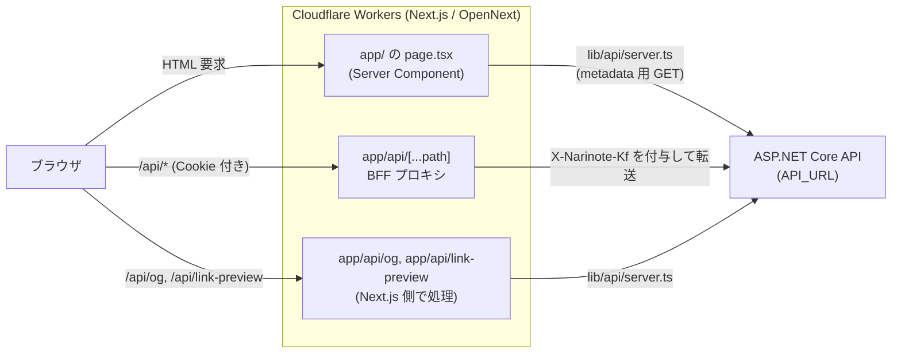
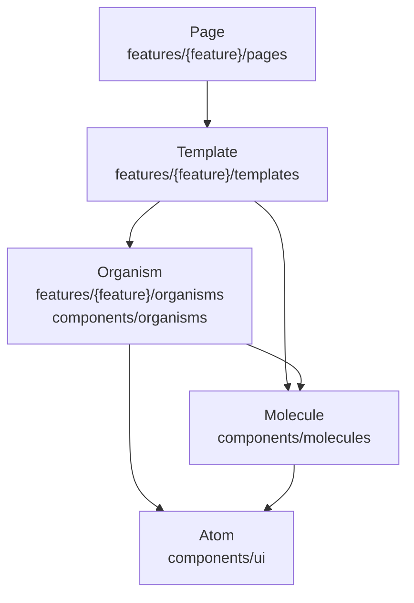
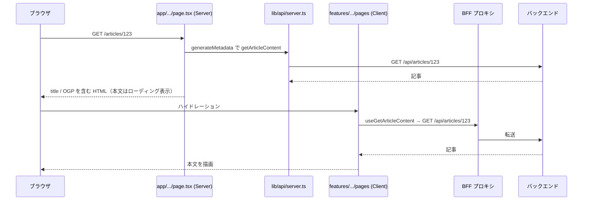
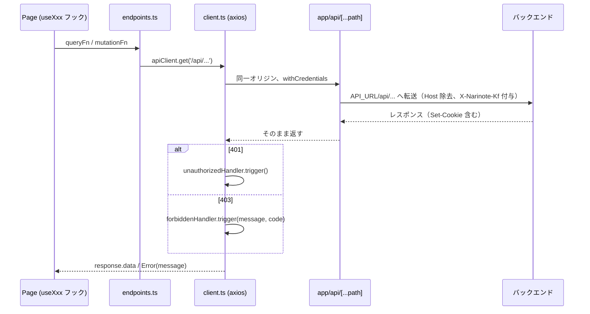
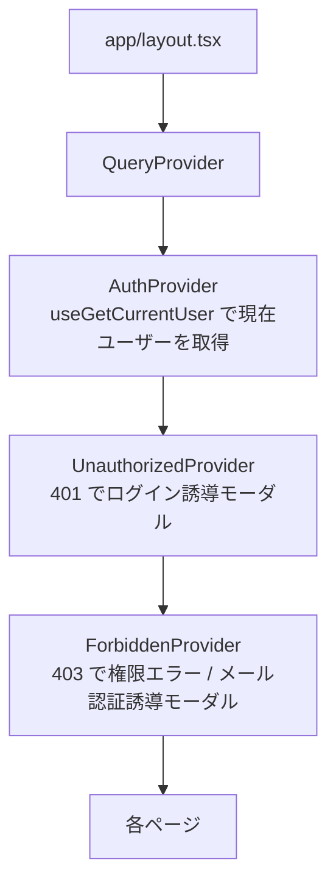

# フロントエンドアーキテクチャ

なりノートのフロントエンドの設計方針をまとめる。技術スタックはルートの [AGENTS.md](../../AGENTS.md)、具体的な追加手順は [implementation-guide.md](./implementation-guide.md)、API コードの生成と使い方は [api-usage.md](./api-usage.md) を参照。

## 全体構成

- ブラウザはバックエンドに直接アクセスしない。クライアントからの API 呼び出しはすべて同一オリジンの `/api/*` に送り、BFF プロキシが `API_URL` に転送する。
- `app/api/` 配下にある個別の Route Handler（OG 画像生成、リンクプレビュー）はキャッチオールより優先されるため、プロキシされずに Next.js 側で処理される。

## ディレクトリの役割

| パス | 役割 |
|---|---|
| `src/app/` | ルーティングのみ。`page.tsx` は metadata の生成と Guard の適用を行い、`features/*/pages` に委譲する |
| `src/features/{feature}/` | 機能ごとのモジュール。`pages/` `templates/` `organisms/` と、必要に応じて機能固有の `types/` など |
| `src/features/global/organisms/` | ヘッダー・フッター・サイドバー・レイアウト・`AuthGuard` など、全体で使う機能ブロック |
| `src/components/ui/` | Atom（shadcn/ui ベースの部品と自作の最小部品） |
| `src/components/molecules/` | 機能をまたいで使う Molecule |
| `src/components/organisms/` | 機能をまたいで使う Organism（記事一覧など） |
| `src/lib/api/` | API クライアントと生成コード（[api-usage.md](./api-usage.md)） |
| `src/lib/providers/` | React Context プロバイダー（Query / Auth / Unauthorized / Forbidden） |
| `src/lib/hooks/` | 機能をまたぐカスタムフック |
| `src/lib/` のその他 | 棋譜プレイヤー（`kif-player/`）、OG 画像、リンクプレビュー、metadata 生成などの共通ロジック |
| `src/types/` | API 型以外で機能をまたぐ型 |

個々のファイル一覧は実際のディレクトリを参照すること。

## 5層 Atomic Design

UI は Page / Template / Organism / Molecule / Atom の 5 層で構成する。依存は上から下への一方向のみ。

| 層 | 責務 | 持たないもの |
|---|---|---|
| Page | データ取得（TanStack Query フック）、状態、イベントハンドラ、ローディング・エラー分岐、Template への props 受け渡し。`'use client'` を付ける | レイアウトやスタイルの記述 |
| Template | ページの UI 構成とレスポンシブ対応。props で受けたデータとコールバックを Organism / Molecule に配る | API 呼び出し、グローバル状態の参照 |
| Organism | 特定の機能に属するまとまった UI（コメント欄、記事フォームの一部など）。それだけで完結する送信処理は内部に持ってよい | ページ全体のデータ取得 |
| Molecule | 機能をまたいで使う複合 UI（カード、フォームフィールド、確認モーダルなど） | 特定機能のロジック |
| Atom | 最小単位の UI（ボタン、入力、ローディング、エラー表示など） | 業務知識 |

配置ルール:

- 2 つ以上の機能で使うものは `components/` に置く（`ui` / `molecules` / `organisms`）。1 機能でしか使わない Organism は `features/{feature}/organisms/` に置く。
- 機能をまたぐページ枠（`MainLayout`、`PageWithSidebar` など）や Guard は `features/global/organisms/` に置く。
- 各ディレクトリの `index.ts` から再エクスポートし、`@/components/ui` のようにディレクトリ単位で import する。

## レンダリング方針

SEO に必要な metadata だけをサーバーで作り、本文はクライアントで取得・描画する。

- `app/` の `page.tsx` は原則 Server Component とし、`params` / `searchParams` を解決して `features/*/pages` の Page に渡すだけにする。公開ページは `generateMetadata` で `lib/api/server.ts` を使い、`lib/metadata.ts` の `buildPageMetadata` で metadata を組み立てる。取得に失敗しても `{}` を返してページ自体は表示する。
- ログイン必須のページは metadata に `robots: { index: false }` を設定し、`AuthGuard`（必要なら `VerifiedEmailGuard`）で Page を包む。
- Page 以下は Client Component で、データは TanStack Query で取得する。
- `server.ts` の fetch は `cache: 'no-store'` で、ページ単位のキャッシュは行わない。
- `sitemap.ts` / `robots.ts`、OG 画像（`app/api/og`）も `server.ts` を使ってサーバー側で生成する。

## API 通信

- `client.ts` の axios インスタンスは `baseURL` が空で、`/api/...` を同一オリジンに送る。Cookie は自動で送受信される。
- レスポンスインターセプターが `response.data` を返すため、呼び出し側は DTO をそのまま受け取る。エラー時はバックエンドの `message` があればそれを `Error` にして reject する。
- FormData 送信時は `Content-Type` を外して boundary をブラウザに付けさせる。
- プロキシは GET / POST / PUT / DELETE を転送する。

## 認証状態

認証は HttpOnly Cookie に入った JWT で行う。フロントエンドはトークンを扱わない。

- `AuthProvider` は `useGetCurrentUser`（`GET /api/auth/me`）の結果から `userId` / `isLoggedIn` / `isEmailVerified` などを `useAuth()` で提供する。メール未認証のときだけ、ウィンドウフォーカスで再取得して別タブでの認証完了を反映する。
- Cookie の発行・削除はバックエンドが行う。ログイン・ログアウト後は現在ユーザーのクエリを取り直して認証状態を更新する（後述の invalidate、または `useAuth().refetch()`）。
- `AuthGuard` は未ログインなら `/login?redirect=...` に遷移させる（`useRequireAuth`）。ハイドレーション不一致を避けるため、マウント前と読み込み中はローディングを表示する。
- `VerifiedEmailGuard` / `useRequireVerifiedEmail` はメール未認証ユーザーの操作を止め、確認メールの再送導線を出す。ボタン操作の前に `ensureVerifiedEmail()` を呼ぶ使い方もある。
- `unauthorizedHandler` / `forbiddenHandler` は React の外（axios インターセプター）から Provider のモーダルを開くための橋渡し。Provider がマウント時にコールバックを登録し、インターセプターが 401 / 403 で `trigger()` する。401 のモーダルからは現在の URL を `redirect` に付けてログインページへ遷移する。
- ログイン後の `redirect` パラメータは、`/` で始まり `//` で始まらない相対パスのみ受け付ける（オープンリダイレクト対策）。

## TanStack Query のキャッシュ方針

`QueryProvider` の既定値は `staleTime` 1 分、`refetchOnWindowFocus: false`、`retry: 1`。

クエリキーは生成された `queryKeys`（`lib/api/hooks.ts`）を使う。

| 種類 | キー |
|---|---|
| パラメータ無しの GET | `[controller, functionName]` |
| パラメータ有りの GET | `[controller, functionName, params]` |

`controller` はバックエンドの Controller 名から作られる小文字の名前（`articles`、`users` など）。

Mutation フックは成功時に、同じ Controller の全クエリ（キー先頭が `[controller]`）を invalidate し、その後で呼び出し側が渡した `onSuccess` を呼ぶ。呼び出し側で `onSuccess` を指定しても、この invalidate は行われる。

- 同じ Controller 内の更新は自動で反映されるため、手動の `refetch()` や `invalidateQueries` は不要。ログイン・ログアウトも `auth` の Mutation なので現在ユーザーのクエリが invalidate される。
- 別の Controller のデータに影響する更新は、呼び出し側の `onSuccess` で `useQueryClient().invalidateQueries({ queryKey: queryKeys.xxx.yyy })` を追加で呼ぶ。
